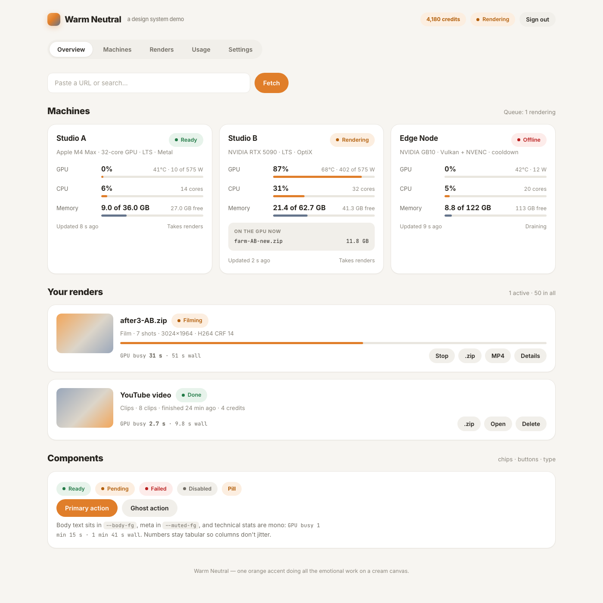

<div align="center">



# Warm Neutral

**A warm, low-chrome design system for dashboards and tools — packaged as an installable agent skill.**

One orange accent doing all the emotional work on a cream canvas.

[](LICENSE)
[](https://code.claude.com/docs/en/skills)
[](#)
[](#)

</div>

## What is this?

**Warm Neutral** is a small, opinionated design system extracted from a production
dashboard ([IG Grabber](https://github.com/syahrularifuddin/ig-grabber) ships it). It
comes in two layers:

1. **A design system** — tokens + component recipes for web UIs: flat cream canvas,
   single orange primary, slate as the sanctioned second data color, hairline-bordered
   white cards, and pills for every interactive element.
2. **An [agent skill](skill/SKILL.md)** — the same system written as instructions an AI
   coding agent (Claude Code, ZCode, or any tool that reads the agent-skills format) can
   load and apply to your project *for you*, consistently, on demand.

The result is calm by default: color appears only where it means something — accent,
status, data.

## Why it looks like this

| Principle | How it shows up |
|---|---|
| Flat canvas | The cream background is flat. No gradients, no noise, no glassmorphism. |
| Hairlines, not heavy borders | Cards are white with a visible 1px border + a barely-there shadow. Depth comes from shadow tokens, never border thickness. |
| One accent | Orange is the only "loud" color, spent on CTAs, active state, and the brand. If everything is orange, nothing is. |
| Color means something | Status is a tinted pill with a dot (green = ok, orange = busy, red = bad). Progress fills encode meaning: orange = active compute, slate = storage/memory. |
| Pills everywhere | Buttons, chips and tabs are 999px; cards 20px; inputs 12px. |
| Numbers behave | Technical stats get a mono font and `tabular-nums` so columns don't jitter. |

## Install

**As an agent skill** (Claude Code, ZCode, or any agent-skills-compatible tool):

```sh
git clone https://github.com/syahrularifuddin/warm-dashboard-ui ~/.agents/skills/warm-dashboard-ui
```

The skill triggers when you ask your agent to *style a UI*, *apply the design system*,
or *make it look warm/soft/cream*. You can also invoke it directly: `/warm-dashboard-ui`.

**For humans**: copy [`references/tokens.css`](references/tokens.css) into your global
stylesheet (or translate to Tailwind `@theme` / CSS-in-JS — tokens are framework-agnostic)
and follow the recipes in [`SKILL.md`](SKILL.md).
Open [`demo/index.html`](demo/index.html) in a browser to see every component with zero build step.

## What's in the box

```
warm-dashboard-ui/
├── SKILL.md              # agent-facing spec: tokens, recipes, rules, workflow
├── references/
│   └── tokens.css        # copy-paste starter: tokens + generic component classes
├── demo/
│   └── index.html        # self-contained showcase (open in a browser)
└── assets/
    └── preview.png       # the screenshot above
```

### Token cheat sheet

| Token | Value | Role |
|---|---|---|
| `--bg` | `#F7F5F1` | Warm off-white canvas (flat) |
| `--card` | `#FFFFFF` | Surface |
| `--border` | `#E9E6E0` | Hairline card border |
| `--fg` / `--body-fg` / `--muted-fg` | `#26231E` / `#6E6A61` / `#8A857B` | Text hierarchy |
| `--primary` | `#E07E2A` | Orange — CTAs, active data, brand |
| `--accent` | `#64748B` | Slate — second *data* color only |
| `--ok-*` / `--warn-*` | green / orange tints | Status chips |
| `--radius` / `--radius-sm` / `--radius-pill` | 20 / 12 / 999 px | Shape scale |

### Component recipes

- **Segmented tabs** — pills sit on a muted track; the active tab is a white pill with a
  border and shadow. Orange is *not* the active-tab color.
- **Buttons** — primary = orange, ghost = muted gray, both pills, weight 600.
- **Status chips** — borderless tinted pill: 7px dot + text in the same hue.
- **Progress bars** — 5px tall, pill radius; fill color carries meaning.
- **Cards** — hairline border + `--shadow-sm`; hover = lift + `--shadow-hover`.
- **Stats** — mono font, tabular numerals, muted labels, dark values.

Full recipes with rationale: [`SKILL.md`](SKILL.md).

## Used in production

The reference implementation is the frontend of
[IG Grabber](https://github.com/syahrularifuddin/ig-grabber) — a Rust + Next.js
Instagram downloader — where every recipe above runs in production.

## Contributing

Issues and PRs welcome. If you adapt the tokens for your product, a screenshot PR to
this README is always appreciated.

## License

[MIT](LICENSE) © 2026 Syahrul
